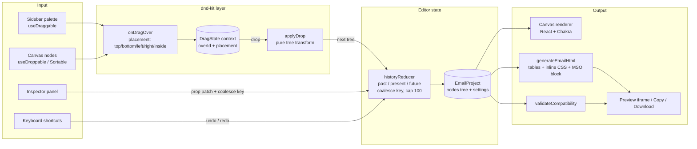

# EmailTemplateFlow: case study (draft)

**Pitch:** A drag-and-drop editor that turns a visual layout into table-based, inline-styled HTML email that survives Outlook, Gmail and mobile clients.

Live demo: https://atifmoin19.github.io/Email-Template-Builder/
Source: https://github.com/Atifmoin19/Email-Template-Builder

---

## The problem

Email HTML is stuck in roughly 2005. Each client renders differently:

- **Outlook on Windows** renders with Microsoft Word's engine. It ignores `max-width`, most `padding` on non-table elements, `border-radius`, flexbox and grid, and reads image size from HTML `width`/`height` attributes rather than CSS.
- **Gmail** strips `<style>` blocks in some contexts and rewrites classes, so anything important must be inline.
- **Mobile clients** need a media query to stack columns, but only clients that keep `<style>` will apply it.

Hand-writing nested tables with inline styles is slow and error-prone, and most visual builders are paid SaaS products. The goal was a free, client-side builder where marketers arrange blocks visually and developers get HTML they can paste into any ESP (Mailchimp, SendGrid, Klaviyo).

## What it does

- Drag blocks (section, column, header, footer, text, image, button, divider, spacer) from a palette onto a canvas, reorder them, and nest content inside multi-column sections.
- Edit properties in an inspector panel; global settings for font, widths and background colours.
- Undo/redo with keyboard shortcuts.
- Preview at desktop, tablet and mobile widths in a sandboxed iframe, see compatibility warnings, then copy or download the HTML.

## Architecture

Everything runs in the browser. The editor keeps one JSON tree (the "email AST") as the single source of truth. The canvas and the exporter are two independent renderers of that tree: React components for editing, and a pure string renderer for output.

Key modules:

| Module | Role |
| --- | --- |
| `types/index.ts` | `EmailNode` tree and typed `EmailNodeProps` |
| `utils/astHelpers.ts` | Immutable find / remove / update on the tree |
| `utils/applyDrop.ts` | Pure drop resolution with layout invariants |
| `hooks/historyReducer.ts` | Snapshot undo/redo with edit coalescing |
| `utils/emailRenderer.ts` | Tree to email-safe HTML string |
| `utils/emailCompatibility.ts` | Static checks shown in the preview |

## Hard decisions and trade-offs

### 1. A JSON tree with two renderers, not "export the canvas DOM"

The canvas uses Chakra components, flexbox and CSS grid because they are pleasant to edit in. None of that is safe in email. Instead of scraping the canvas DOM, the export walks the same JSON tree and emits tables directly.

- **Gain:** the output is fully controlled and testable as a pure function (`generateEmailHtml(project) => string`); the canvas can use modern CSS freely.
- **Cost:** two renderers can drift. During the revival, tests caught exactly that: font weight set in the inspector showed on the canvas but was never exported, and the global font never reached nested text. The fix was a Vitest suite that pins down what the exporter emits for each prop.

### 2. Tables and inline styles everywhere

Sections become a `<table>` grid where each child is a `<td width="N%">` with `colspan`, wrapped in a centred container table with a `max-width`. Every style is inlined via a small `objectToInlineCss` helper; the only `<style>` block holds the mobile media query and an `<!--[if mso]>` rule for `border-collapse`.

- **Gain:** layout holds in Outlook's Word engine and in Gmail when `<style>` is stripped.
- **Cost:** verbose HTML, and anything that relies on the `<style>` block (column stacking on mobile) degrades in clients that strip it. Columns then stay side by side, which is readable but not ideal.
- **Honest limit:** Outlook-specific code is currently minimal. Buttons are bulletproof table buttons but without VML, so Outlook drops rounded corners, and there are no MSO "ghost tables" for fixed-width columns. Both are on the roadmap.

### 3. Snapshot history in a pure reducer, with coalescing

Undo/redo stores full `EmailProject` snapshots (`past`, `present`, `future`) rather than diffs or command objects.

- **Gain:** trivially correct, since the tree is updated immutably and snapshots share unchanged subtrees.
- **Cost:** memory grows with edits, so history is capped at 100 entries.
- The first version rebuilt state from render closures, so two updates in one tick could read stale state, and every keystroke was its own undo step. Moving it into `useReducer` fixed the first. For the second, each inspector edit carries a coalesce key (`props:<nodeId>:<fields>`) and consecutive edits with the same key collapse into one step. That is deterministic and testable, unlike a time-window debounce.

### 4. Drop logic as a pure function with explicit invariants

dnd-kit reports what the pointer is over; deciding what that means is the app's job. `onDragOver` computes a placement (`top`, `bottom`, `left`, `right`, `inside`) from pointer and target geometry and stores it in a small context so containers can draw placeholders. On drop, `applyDrop` turns that into a new tree, or `null` for an invalid drop. It enforces three rules: sections, headers and footers live only at the root; content always lives in a container; a node can never be dropped into its own subtree.

- **Gain:** the rules are unit-tested without a browser, and an earlier bug (headers and footers could be nested inside sections) is now covered by a test.
- **Cost:** placement uses a 20px edge threshold and centre-line comparisons, which feels right for typical block sizes but can be fiddly with very small elements.

### 5. Plain-text content, escaped on export

Text and button labels are edited as plain text and rendered literally on the canvas. The exporter originally interpolated them raw, so a `&` or `<` produced broken HTML, and a `"` in an alt or link broke the attribute. Everything user-supplied is now escaped.

- **Gain:** what you see is what you export, and the output is well-formed.
- **Cost:** no inline rich text (bold a single word, inline links) yet. A rich-text editor was in the dependency list but never wired up; it was removed rather than shipped half-done.

### 6. Fully client-side, deployed as a static site

No backend: the app is a Vite build on GitHub Pages using a hash router so deep links work without server rewrites. The builder route is lazy-loaded so the landing page does not ship the editor.

- **Gain:** free hosting, nothing to operate, privacy by default.
- **Cost:** no saved templates or sharing yet; refreshing the page loses work.

## Results (measured)

All numbers below were measured locally on the `revive` branch (2026-10-31).

| Metric | Value |
| --- | --- |
| Unit tests | 33 passing across 4 files (exporter 14, drop logic 9, history 7, compatibility checks 3) |
| Lint | 0 ESLint errors (was 16) |
| Entry JS chunk | 527.09 kB, 171.80 kB gzip (was 699.11 kB / 223.15 kB before lazy-loading the builder) |
| Builder chunk | 175.52 kB, 53.51 kB gzip, loaded on demand |
| Lighthouse, landing page (mobile, simulated throttling, local `vite preview`) | Performance 98, Accessibility 100, Best Practices 100, SEO 100 |
| Lighthouse, builder (desktop preset, local `vite preview`) | Performance 98, Accessibility 96 (colour contrast), Best Practices 100 |
| `npm audit` | 31 advisories (12 high) reduced to 12 moderate, all in the dev-only ESLint toolchain |

Lighthouse was run against a local production build, not the live site, so real-world numbers will differ.

**On "reduced email creation time by 60%":** nothing in the repository supports this figure (no user study, timing data or analytics). Do not publish it unless there is a measurement behind it. A defensible alternative is a qualitative statement, or run a small timed comparison (for example, rebuilding the OTP template by hand versus in the builder) and report that number with its method.

## Screenshots to capture

1. Landing page hero (existing: `src/assets/LandingPage.png`).
2. Builder with the Newsletter preset: two-column section, inspector open on a button.
3. Mid-drag: dragging a column beside another, with the placeholder visible.
4. Preview modal at mobile width showing columns stacked, with the compatibility panel listing a real warning (for example an image without alt text).
5. The exported HTML open in a code editor next to the same email rendered in a mail client (Outlook if available).
6. Short GIF: build a block, press Cmd+Z / Shift+Cmd+Z.
7. Terminal or CI screenshot: `npm test` with 33 passing, plus the green GitHub Actions run once the workflow is enabled.

## What's next

- Outlook-grade output: VML rounded buttons and MSO ghost tables for multi-column rows, then verify in real clients (Litmus / Email on Acid, or manual sends).
- Starter template gallery (welcome, receipt, password reset, newsletter) selectable from the top bar.
- Autosave to local storage and a shareable link that encodes the template tree in the URL.
- Inline rich text (bold, italic, links) with a sanitiser on export.
- Accessibility pass on the builder UI (colour contrast flagged by Lighthouse) and keyboard-only drag and drop.
