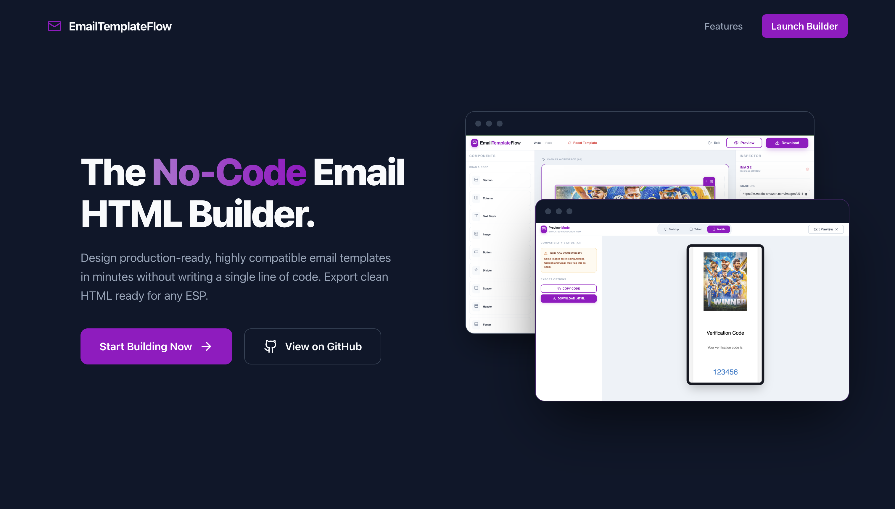
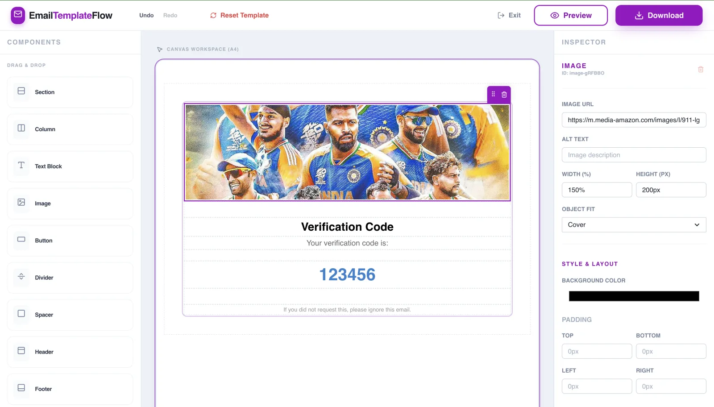
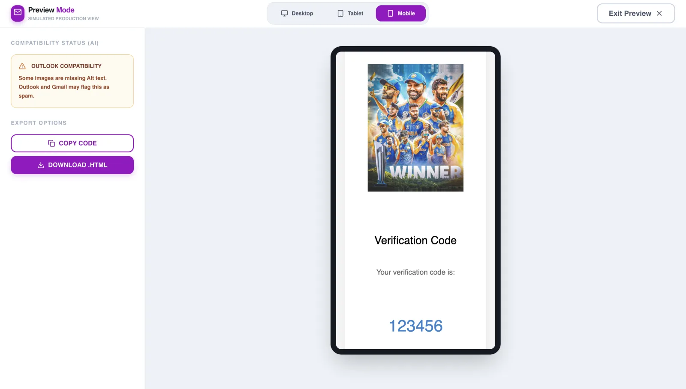

# 📧 EmailTemplateFlow

**The world's easiest No-Code Email HTML Template Builder.**

[](https://Atifmoin19.github.io/Email-Template-Builder/)

**EmailTemplateFlow** is a powerful, open-source drag-and-drop email builder designed to create production-ready, highly compatible HTML email templates without writing a single line of code.

🚀 **[Try the Live Demo](https://atifmoin19.github.io/Email-Template-Builder/)**

---

### 🎨 Visual Showcase

#### 1. Landing Page


#### 2. Main Builder


#### 3. Instant Preview


---

## ✨ Key Features

- 🏗️ **No-Code Drag & Drop**: Effortlessly build complex layouts with our intuitive visual editor.
- 📱 **Mobile Responsive**: Built-in responsive design ensures your emails look great on any device.
- 🛡️ **Email-client friendly output**: Exports table-based layout with inline styles, plus an Outlook-only (`<!--[if mso]>`) `border-collapse` fix. Not yet included: VML ("bulletproof") buttons or MSO ghost tables for multi-column layouts, so test complex designs in Outlook desktop before sending.
- 🔄 **Undo/Redo Support**: Experiment with confidence thanks to full history management.
- 🖼️ **Asset Management**: Real-time image editing and placeholder support.
- 💾 **Export Options**: 
  - **Copy Code**: Instant access to the generated HTML.
  - **Download .HTML**: Get a ready-to-use file for your ESP (Mailchimp, Klaviyo, SendGrid, etc.).
- 💾 **Autosave**: Your current design is saved to this browser (localStorage) and restored when you reopen the builder.
- 🧩 **Starter templates**: OTP, Newsletter, Welcome, Order receipt and Password reset presets. Applying one is undoable.
- ♻️ **New template**: Start from a blank canvas (asks for confirmation first).

---

## 🛠️ Tech Stack

- **Frontend**: [React 19](https://reactjs.org/) + [TypeScript](https://www.typescriptlang.org/)
- **Styling**: [Chakra UI](https://chakra-ui.com/) (Premium custom theme)
- **Drag & Drop**: [@dnd-kit](https://dndkit.com/)
- **Build Tool**: [Vite](https://vitejs.dev/)
- **Icons**: [Lucide React](https://lucide.dev/)
- **Animations**: [Framer Motion](https://www.framer.com/motion/)

---

## 🚀 Getting Started

### Prerequisites

- Node.js (v18 or higher)
- npm or yarn

### Installation

1. **Clone the repository:**
   ```bash
   git clone https://github.com/Atifmoin19/Email-Template-Builder.git
   cd Email-Template-Builder
   ```

2. **Install dependencies:**
   ```bash
   npm install
   ```

3. **Start the development server:**
   ```bash
   npm run dev
   ```

4. **Build for production:**
   ```bash
   npm run build
   ```

5. **Run the tests and linter:**
   ```bash
   npm test
   npm run lint
   ```

---

## 🌎 Deployment

The project deploys to **GitHub Pages** through `.github/workflows/deploy.yml`: every push and pull request runs lint, tests and a build, and pushes to `main` deploy `dist/`. This needs the repository's Pages source set to **GitHub Actions** (Settings > Pages).

Manual deployment via the `gh-pages` branch still works:

1. Update the `homepage` field in `package.json` with your URL.
2. Run the deployment script:
   ```bash
   npm run deploy
   ```

---

## 📄 License

License: not specified yet.

Developed with ❤️ by [Atif Moin](https://github.com/Atifmoin19)
